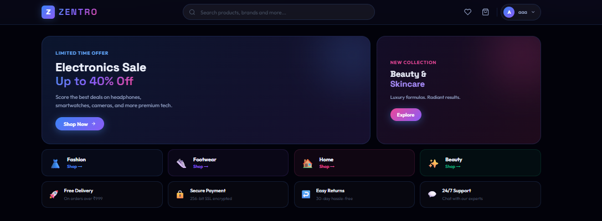

# ZENTRO – The Future of Shopping

A modern, full-stack e-commerce web application developed using React, TypeScript, Node.js, Express.js, and NeDB.

ZENTRO provides a complete online shopping experience with customer authentication, product browsing, shopping cart, wishlist, checkout, order tracking, automated email notifications, and an administration portal.

## Project Overview

ZENTRO is a college academic project designed to demonstrate the development of a full-stack e-commerce application.

The application provides a modern dark-themed shopping interface for customers and an administration portal for managing products, customers, and orders.

It includes customer registration and login, product browsing, cart and wishlist management, checkout, order placement, delivery tracking, and automated email notifications.

## Project Screenshots

### 1. Home Page


### 2. Features



### 3. Admin Dashboard


### 4. Login Successful Email


### 5. Order Information


### 6. Order Placed


### 7. Order Placed – Additional View


### 8. Order Confirmation Email


### 9. Order Confirmation Email – Additional View


### 10. Track Order


## Key Features

### 1. Customer Storefront

- Product catalog with 46+ products.
- Five product categories:
  - Fashion
  - Electronics
  - Beauty
  - Home
  - Footwear
- Product search and category filtering.
- Product ratings and review counts.
- Product labels such as HOT, SALE, NEW, and TRENDING.
- Modern responsive user interface.

### 2. Customer Authentication

- Customer registration and login.
- Email validation.
- Password hashing using bcryptjs.
- JWT-based authentication.
- Customer account management.

### 3. Shopping Cart and Wishlist

- Add products to the shopping cart.
- Increase or decrease product quantities.
- Remove products from the cart.
- Add and remove wishlist products.
- Automatic subtotal calculation.
- Shipping charge calculation.
- GST calculation.
- LocalStorage-based data persistence.

### 4. Checkout and Payment

- Indian shipping address form.
- Mobile number validation.
- PIN code validation.
- Cash on Delivery (COD).
- Online payment simulation.
- UPI, Google Pay, PhonePe, and card payment options.
- Order confirmation screen.

**Note:** Online payment is simulated for educational and testing purposes. No real financial transactions are processed.

### 5. My Orders and Order Tracking

- View customer order history.
- Display order details and purchased products.
- Track delivery progress.
- Order status updates:
  - Processing
  - Confirmed
  - Packed
  - Shipped
  - Out for Delivery
  - Delivered

### 6. Admin Dashboard

- Separate admin login.
- Protected administration portal.
- Total revenue overview.
- Total orders overview.
- Total customers overview.
- Product catalog management.
- Customer order management.
- Update order delivery status.
- Product and order synchronization with the backend.

### 7. Email Notifications

- Automated order confirmation emails.
- Gmail SMTP integration using Nodemailer.
- Product images embedded in email notifications using CID attachments.
- Email notifications after successful order placement.

## Technology Stack

| Category | Technologies |
|---|---|
| Frontend | React 18, TypeScript |
| Build Tool | Vite |
| Styling | CSS, Flexbox, CSS Grid |
| Backend | Node.js, Express.js |
| Database | NeDB |
| Authentication | JWT, bcryptjs |
| Email Service | Nodemailer, Gmail SMTP |
| API Communication | REST API |
| Data Persistence | LocalStorage |
| Development Tools | VS Code, npm, Git, GitHub |

## Project Architecture

```text
ZENTRO/
│
├── backend/
│   ├── routes/
│   │   ├── admin.js
│   │   ├── auth.js
│   │   └── orders.js
│   │
│   ├── utils/
│   │   └── mailer.js
│   │
│   ├── createAdmin.js
│   ├── resetAdminPassword.js
│   ├── fixAdminEmail.js
│   ├── db.js
│   ├── ordersDb.js
│   ├── productsDb.js
│   ├── .env.example
│   └── server.js
│
├── public/
│
├── Screenshot/
│   ├── Admin dashboard.png
│   ├── Features.png
│   ├── Home page.png
│   ├── Login successfull email.png
│   ├── Order Placed.png
│   ├── Order confired email.png
│   ├── Order confirmed email 2.png
│   ├── Order info.png
│   ├── Order placed 2.png
│   └── Track order.png
│
├── src/
│   ├── components/
│   ├── context/
│   ├── data/
│   ├── Pages/
│   ├── styles/
│   └── App.tsx
│
├── .gitignore
├── README.md
├── index.html
├── package.json
├── package-lock.json
├── tsconfig.json
└── vite.config.ts
```

## Getting Started

Follow these steps to run the project on your local computer.

### 1. Prerequisites

Install the following software:

- Node.js (version 18 or higher recommended)
- npm
- Visual Studio Code
- Git

### 2. Clone the Repository

```bash
git clone https://github.com/AnanyaNPuthran/ZENTRO.git
```

Navigate to the project folder:

```bash
cd ZENTRO
```

### 3. Install Dependencies

Install frontend dependencies:

```bash
npm install
```

Install backend dependencies:

```bash
npm install --prefix backend
```

### 4. Configure Environment Variables

Create a `.env` file inside the backend folder using `.env.example` as a reference.

Configure the following variables:

```env
PORT=3001
JWT_SECRET=your_secret_jwt_key
JWT_EXPIRES=30d

EMAIL_USER=your_email@gmail.com
EMAIL_PASSWORD=your_google_app_password
```

Use your own credentials. Never upload your actual `.env` file, Gmail App Password, or secret keys to GitHub.

Email configuration is optional. Without Gmail credentials, order placement can continue without sending email notifications.

### 5. Create an Admin Account

Run the following command:

```bash
node backend/createAdmin.js
```

Follow the instructions to enter the admin name, email, and password.

### 6. Run the Application

Start the frontend and backend together:

```bash
npm run dev
```

The application will be available at:

| Service | URL |
|---|---|
| Frontend | http://localhost:5173 |
| Backend API | http://localhost:3001 |
| Admin Portal | http://localhost:5173/admin |

Note: Vite may select another available port if port 5173 is already occupied.

## Security

- Passwords are hashed using bcryptjs.
- JWT tokens are used for authentication.
- Environment variables are stored separately.
- Sensitive configuration files are excluded using `.gitignore`.
- Local database files are excluded from GitHub.
- Admin routes require authentication.

## Future Enhancements

- Integration with a real payment gateway.
- Advanced sales analytics and reporting.
- Product reviews and customer feedback.
- Improved product recommendation system.
- Cloud database integration.
- Live application deployment.

## Project Information

**Project Name:** ZENTRO – The Future of Shopping

**Project Type:** Full-Stack E-Commerce Web Application

**Project Purpose:** College Academic Project

**Frontend:** React and TypeScript

**Backend:** Node.js and Express.js

**Database:** NeDB

## Author

**Ananya N Puthran**

GitHub: https://github.com/AnanyaNPuthran

## Repository

https://github.com/AnanyaNPuthran/ZENTRO

## License

This project is licensed under the MIT License.
